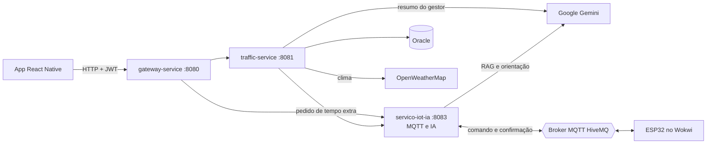

# Travessia Inteligente

Global Solution - FIAP - Disruptive Architectures: IoT, IoB & Generative IA

Integrante | RM 

Erik Naoki Miyasato | 565771 
Gustavo Arthur Carvalho Sartori | 561650 
Gutemberg Rocha Silva | 562267 
João Henrique Batista Leal | 564361 
Juliana da Silva Stigliani | 561171  


## Funcionalidade

O tempo de verde para pedestres costuma ser curto para pessoas idosas e pessoas com deficiência, e o risco aumenta com chuva. No Travessia Inteligente, a pessoa cadastrada (60+ ou PCD) se aproxima do semáforo (até 10 m, pelo GPS) e pede mais tempo pelo aplicativo: +5 s com tempo seco e +10 s com chuva. O pedido chega ao semáforo (ESP32 simulado no Wokwi) por MQTT, e o app acompanha a contagem até o sinal fechar.

A IA generativa (Google Gemini) entra em três pontos:

| Funcionalidade | O que a IA faz |
|---|---|
| Assistente de dúvidas (aba Dúvidas) | Responde com RAG sobre o app e sobre segurança na travessia, com memória de conversa, fontes, sugestões de próximas perguntas e modo "mais simples". A resposta pode ser ouvida em voz alta |
| Orientação depois do pedido | Escreve dicas de segurança da base de conhecimento adequadas ao clima e ao horário |
| Resumo para o gestor (perfil ADMIN) | Escreve um resumo com recomendações a partir de indicadores agregados das solicitações |

Tema CitizenTech, ODS 11 (cidades acessíveis), ODS 3 (segurança no trânsito) e ODS 10 (redução das desigualdades).

## Arquitetura



- **App** (repositório `GS_ReactNative_TravessIA`): Expo/React Native. Fala só com o gateway.
- **Backend** (repositório `GS_Java_TravessIA`): Java 21, Spring Boot 3.3, JWT, Oracle, Flyway, OpenFeign e Spring AI.
- **servico-iot-ia** (este repositório): Python, FastAPI, paho-mqtt e NumPy. Envia os comandos ao ESP32, acompanha as confirmações e contém o assistente com RAG.
- **esp32-semaforo** (este repositório): semáforo com 5 LEDs e 2 LCDs (contagem e nome do semáforo).

Fluxo de um pedido: o app envia a posição, o backend valida a distância e consulta o clima, e o serviço Python publica `semaforo/{id}/comando` no broker. O ESP32 responde `ACEITO` e depois `EXECUTADO`, quando o verde de pedestres com o extra começa. O app só mostra sucesso com a confirmação do semáforo e acompanha a contagem pelo relógio do ESP32 (`GET /api/dispositivo/estado`).

## Justificativas técnicas

- **RAG como aprofundamento.** O assistente precisa responder com as regras reais do projeto (15 s, +5/+10 s, 10 m, quem pode se cadastrar) sem inventar. O RAG limita a resposta a documentos escritos pela equipe e mostra a fonte. Machine Learning ou Deep Learning exigiriam dados rotulados que o projeto não tem, e não há uso de câmera para Visão Computacional.
- **Gemini por API.** Roda em um computador comum, tem cota gratuita e oferece modelos de texto e de embedding na mesma API. Os modelos são pré-treinados. Se um modelo falha por cota ou indisponibilidade, o próximo da lista é usado.
- **Tempo extra por regra fixa, sem IA.** "Está chovendo?" tem uma resposta objetiva: o código da condição do OpenWeatherMap (2xx, 3xx, 5xx e 6xx são tempestade, garoa, chuva e neve). É instantâneo, não gasta cota e tem teste automatizado.
- **Busca vetorial em memória.** A base tem 64 trechos e a busca com NumPy leva milissegundos, então um banco vetorial seria desnecessário. Uma busca híbrida (vetores + BM25) foi implementada e comparada. Com o modelo `gemini-embedding-2` ela foi pior (Hit@1 de 84% a 88% contra 96%), então a vetorial ficou como padrão (`RAG_MODO_BUSCA`).
- **Broker público.** É o que o Wokwi consegue acessar. Nenhum dado pessoal trafega por MQTT.

## Dados

| Fonte | Uso |
|---|---|
| `base-conhecimento/` (13 documentos escritos pela equipe) | Base do RAG: funcionamento do app, regras, privacidade, equipe e orientações gerais de segurança, citando o Código de Trânsito (Lei 9.503/1997), a Lei Brasileira de Inclusão (Lei 13.146/2015), o Estatuto da Pessoa Idosa (Lei 10.741/2003) e a Lei 11.126/2005 |
| OpenWeatherMap | Código e descrição do clima no local do semáforo |
| Oracle (backend) | Usuários, semáforos e solicitações. Para a IA vão só contagens agregadas (resumo do gestor) |
| `servico-iot-ia/avaliacao/*.json` | Casos de teste da avaliação |

Preparação: cada documento é dividido pelas seções `##` (até 900 caracteres, com um parágrafo de sobreposição), cada trecho vira um vetor de embedding do Gemini e o índice é salvo em `servico-iot-ia/dados/` (não versionado). Ele é recriado sozinho quando a base ou o modelo mudam. Na pergunta, entram os 4 trechos mais parecidos, desde que a similaridade de cosseno seja de pelo menos 0,62. Abaixo disso, a IA não é chamada.

**Guardrails do assistente** (`servico-iot-ia/app/faq/guardrails.py`):
1. Um filtro de entrada bloqueia injeção de prompt, pedido das instruções, troca de papel, código, dados pessoais e uso indevido.
2. Perguntas fora do tema são recusadas pelo limiar de similaridade e, na faixa duvidosa, por um classificador de escopo.
3. As instruções do modelo limitam a resposta ao contexto.
4. Um filtro de saída descarta respostas que vazem as instruções, tragam código ou links ou citem números que não estão nos trechos.

Na orientação e no resumo do gestor, o texto da IA só é usado se os números citados conferirem com os dados.

## Execução local

Pré-requisitos: Java 21, Maven, Python 3.11+, Node 20+, chave do Gemini, acesso ao Oracle e conta no Wokwi. Clone os três repositórios lado a lado.

```bash
# 1. Alterações de integração no app e no backend (base: commits 0a9da8c e 01d02ed)
cd GS_Java_TravessIA && git apply ../GS-Disruptive-TravessIA/integracao/backend-java.patch
cp ../GS-Disruptive-TravessIA/integracao/backend-arquivos/traffic-service/src/main/resources/application.yml traffic-service/src/main/resources/
cd ../GS_ReactNative_TravessIA && git apply ../GS-Disruptive-TravessIA/integracao/frontend-react-native.patch

# 2. Serviço Python (porta 8083)
cd ../GS-Disruptive-TravessIA && cp .env.example .env    # preencher GEMINI_API_KEY
cd servico-iot-ia && python3 -m venv .venv && .venv/bin/pip install -r requirements.txt
.venv/bin/uvicorn app.main:app --port 8083

# 3. Backend (portas 8081 e 8080), dentro de GS_Java_TravessIA
cp .env.example .env    # preencher ORACLE_USER, ORACLE_PASSWORD e WEATHER_API_KEY
mvn -q -DskipTests package
java -jar traffic-service/target/traffic-service-0.0.1-SNAPSHOT.jar
java -jar gateway-service/target/gateway-service-0.0.1-SNAPSHOT.jar

# 4. App (porta 8082), dentro de GS_ReactNative_TravessIA
npm install && npm start
```

ESP32: crie um projeto ESP32 no [Wokwi](https://wokwi.com), cole `esp32-semaforo/sketch.ino`, `diagram.json` e `libraries.txt` e clique em Play.

App: no simulador iOS ou na web usa `http://localhost:8080/api`, e no emulador Android usa `10.0.2.2`. Em celular físico, defina `EXPO_PUBLIC_API_URL` no `.env` do app. Usuários de teste: `maria_silva` (USUARIO) e `admin_gutemberg` (ADMIN).

Variáveis principais (os arquivos `.env.example` listam todas, sem valores secretos):

| Variável | Onde | Uso |
|---|---|---|
| `GEMINI_API_KEY` | serviço Python (obrigatória) e backend (opcional, só resumo do gestor) | IA |
| `ORACLE_USER`, `ORACLE_PASSWORD` | backend | banco |
| `WEATHER_API_KEY` | backend (opcional) | clima. Sem ela, considera tempo seco |
| `MQTT_BROKER_URL`, `MQTT_TOPICO_BASE` | serviço Python | broker e tópicos |
| `RAG_LIMIAR_SIMILARIDADE`, `RAG_MODO_BUSCA` | serviço Python | RAG |

### Alterações no app e no backend

Os repositórios originais não foram alterados no GitHub. As mudanças estão em `integracao/` como patches:
- **Backend:**
  - cliente do serviço IoT;
  - status do semáforo na solicitação (migração `V2`);
  - regra do tempo extra pelo código do clima;
  - rotas do assistente, da orientação, do estado do semáforo e do resumo do gestor no gateway;
  - resumo com IA;
  - configuração por `.env`.
- **App:**
  - endereço da API por plataforma;
  - confirmação e contagem sincronizadas com o ESP32;
  - orientação da IA;
  - aba Dúvidas;
  - resumo do gestor no Histórico;
  - leitura em voz alta (`expo-speech`).

## Testes e resultados

| Teste | Comando (em `servico-iot-ia/`) | Resultado |
|---|---|---|
| Unitários Python | `.venv/bin/pytest` | 49/49 |
| Unitários Java (regra do clima) | `mvn test -pl traffic-service -am` (no backend) | 4/4 |
| Avaliação da IA ([relatório](docs/avaliacao-rag.md)) | `.venv/bin/python -m avaliacao.avaliar_rag` | 32/33 respostas corretas |
| Segurança e falhas da IA ([relatório](docs/avaliacao-seguranca-ia.md)) | `.venv/bin/python -m avaliacao.avaliar_seguranca_ia` | 23/23 casos e 6/6 falhas tratadas |
| Integração com o ESP32 ([relatório](docs/testes-integracao.md)) | `.venv/bin/python -m avaliacao.testar_integracao --semaforo-chuva <id>` | 17/17 |

Métricas da avaliação da IA (33 perguntas e 5 orientações; a última execução usou o embedding reserva `gemini-embedding-001`, porque a cota do `gemini-embedding-2` tinha acabado):

| Métrica | Resultado |
|---|---|
| Respostas corretas com os fatos esperados | 24/25 |
| Recusa correta de perguntas fora da base | 8/8 |
| Perguntas de acompanhamento (com histórico) | 5/5 |
| Fidelidade ao contexto, conferida por outro modelo (`gemini-3.1-flash-lite`) | 23/24 |
| Orientações com os segundos corretos e fiéis à base | 5/5 |
| Hit@1 / Hit@4, busca vetorial | 76% / 96% (96% / 100% com `gemini-embedding-2` em rodadas anteriores) |

Segurança: 17/17 ataques e perguntas fora do tema recusados, 6/6 perguntas legítimas respondidas e nenhum vazamento das instruções. Com o Gemini indisponível, o assistente responde 503, a orientação usa um texto padrão, o resumo é montado sem IA e o tempo extra continua funcionando.

Integração: com chuva real, o pedido recebeu +10 s, e a travessia foi medida em 25 s no relógio do ESP32. A travessia padrão mediu 15,0 s, as fases nunca têm dois verdes ao mesmo tempo, o pedido duplicado é tratado e pedidos simultâneos recebem 409.

Evidências em `docs/evidencias/`: contagem até o sinal abrir, "Atravesse agora", orientação da IA, travessia concluída, assistente e resumo do gestor.

## Limitações

- O broker MQTT é público e sem autenticação. Em produção seria necessário um broker próprio com TLS e usuário por dispositivo.
- Um único ESP32 simulado atende todos os semáforos. O Wokwi pode rodar mais devagar que o tempo real.
- A IA depende da cota gratuita do Gemini. Com o embedding reserva, a busca acerta menos.
- O avaliador de fidelidade também é uma IA e pode errar. As afirmações apontadas ficam no relatório para conferência.
- As orientações de segurança são gerais e não substituem órgãos de trânsito, profissionais de saúde ou advogados.
- O banco Oracle é compartilhado e contém registros de teste.

## Uso de IA no desenvolvimento

A equipe usou um assistente de programação com IA (Claude Code, da Anthropic) para apoiar a análise do código, a escrita da integração, dos testes e desta documentação. Os requisitos, as decisões e a validação dos resultados foram feitos pela equipe. Todos os resultados vêm de execuções reais.
